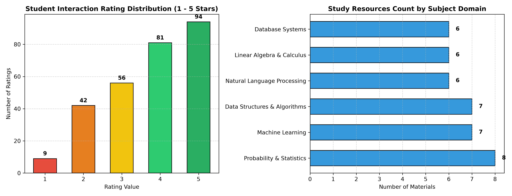
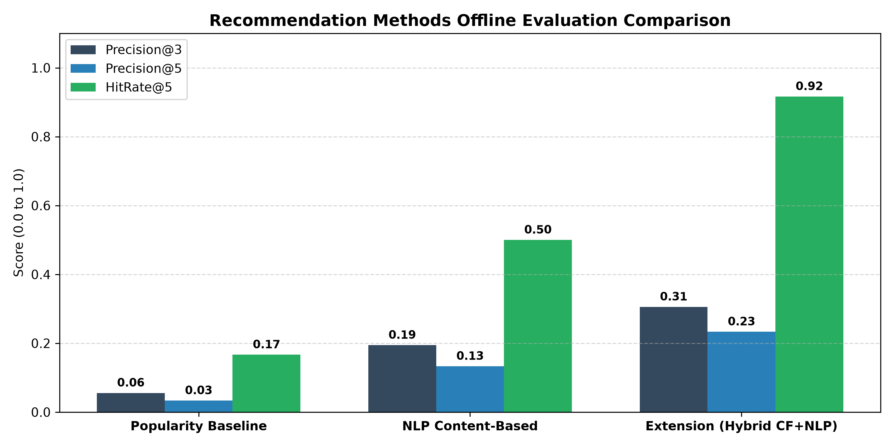

# Study Resource and Exam Prep Material Recommender (MP-C15)

**CS467 Advanced Artificial Intelligence — Mini-Project Assignment 15**  
**Duy Tan University | Academic Year 2026-2027**

---

## 1. Project Information & Metadata

| Field | Details |
| :--- | :--- |
| **Student Name** | Chu Văn Nhật Thanh |
| **Student ID** | 29211125861 |
| **Class / Section** | CS467C (No. 15) |
| **Instructor** | Puri Vikram |
| **Assigned Project Code** | MP-C15 |
| **Assigned Project Title** | Study Resource and Exam Prep Material Recommender |
| **Application Domain** | Student Learning Hub |
| **Repository Name** | `cs467-miniproject-29211125861` |
| **Repository URL** | https://github.com/nhatthanh123456/cs467-miniproject-29211125861 |

---

## 2. Problem Statement & Assigned Scenario

Before exams, university students frequently experience cognitive overload when searching through voluminous textbooks and generic lecture slides. They urgently require **concise notes, cheatsheets, and worked practice sets** that address the exact topics they find confusing.

This project delivers a specialized **Study Resource & Exam Prep Material Recommender** for a Student Learning Hub. The system integrates:
1. **Natural Language Processing (NLP)** over resource summaries, lecture outlines, and syllabus concept tags to semantically interpret free-text queries and target weak topics.
2. **Collaborative Filtering & Hybrid Recommendation** combining peer student usefulness ratings with NLP concept matching to generate personalized, explainable study recommendations while mitigating cold-start challenges for newly uploaded exam aids.

---

## 3. Dataset Description

The project utilizes two domain-tailored datasets located in [`data/`](./data/):

### 3.1 Study Resources Dataset (`data/items.csv`)
- **Total Resources**: 40 curated study items (`RES001` to `RES040`).
- **Subject Coverage**: 6 core CS/AI disciplines:
  - *Probability & Statistics* (7 resources)
  - *Machine Learning* (7 resources)
  - *Natural Language Processing* (6 resources)
  - *Data Structures & Algorithms* (7 resources)
  - *Linear Algebra & Calculus* (6 resources)
  - *Database Systems* (7 resources)
- **Resource Types**: *Practice Set*, *Cheatsheet*, *Study Guide*, *Lecture Notes*, *Exam Review*.
- **Schema**:
  - `item_id`: Unique identifier (e.g., `RES001`).
  - `resource_title`: Title of the educational material.
  - `subject`: Academic discipline.
  - `resource_type`: Format of the material.
  - `summary_text`: Detailed description of coverage, worked exercises, and formulas.
  - `concept_tags`: Semicolon-delimited syllabus keywords.

### 3.2 Student Interactions & Ratings Dataset (`data/ratings.csv`)
- **Total Interactions**: 282 verified student ratings.
- **Students**: 15 students (`STU001` to `STU015`) representing realistic academic personas (Math/ML, AI/NLP, and Core Systems).
- **Ratings per Student**: 15 to 22 ratings (exceeding the course minimum of 4–6).
- **Ratings per Item**: 3 to 11 ratings across all 40 items.
- **User-Item Matrix Sparsity**: **53.00%** missing entries (within the required 40%–65% realistic sparsity range).
- **Schema**:
  - `user_id`: Unique student identifier.
  - `item_id`: Rated resource ID.
  - `rating`: Integer score from 1 (unhelpful) to 5 (highly effective for exam prep).
  - `study_comment`: Qualitative student feedback explaining usefulness.

---

## 4. NLP Pipeline & Recommendation Methods

### 4.1 NLP Text Preprocessing & Feature Extraction (`src/nlp_pipeline.py`)
- **Cleaning & Normalization**: Custom pipeline performing lowercasing, concept delimiter normalization, punctuation removal, and academic stop-word stripping.
- **TF-IDF Vectorization**: Unigram and bigram representation ($1, 2$) with sublinear term-frequency scaling (`sublinear_tf=True`), capturing composite academic phrases such as `"bayes theorem"`, `"normal distribution"`, `"dynamic programming"`, and `"knapsack"`.
- **Query Vectorization**: Provides seamless out-of-vocabulary safe vectorization using the fitted vocabulary.
- **Explainability**: Dynamic extraction of non-zero shared TF-IDF concepts to provide clear rationales for each recommendation.

### 4.2 Recommendation Approaches (`src/recommender.py`)

1. **Popularity Baseline**:
   - Computes Bayesian weighted average rating:
     $$W = \frac{v}{v + m} \cdot R + \frac{m}{v + m} \cdot C$$
     where $v$ is rating count, $m=2$ is the threshold, $R$ is item mean, and $C$ is the global rating mean ($3.69\star$).
   - Automatically filters out materials the target student has already reviewed.

2. **NLP Content-Based Recommender**:
   - Computes Cosine Similarity across TF-IDF feature space:
     $$\text{CosineSim}(\mathbf{u}, \mathbf{v}) = \frac{\mathbf{u} \cdot \mathbf{v}}{\|\mathbf{u}\|_2 \|\mathbf{v}\|_2}$$
   - Supports:
     - **Free-Text Search Query**: Matches search descriptions to material content.
     - **Item-to-Item Follow-up**: Suggests follow-up study guides given a seed item.
     - **User Profile Matching**: Aggregates a rating-weighted concept vector representing the student's study strengths and interests.

3. **Item-Based Collaborative Filtering (IBCF)**:
   - Constructs student-resource utility matrix and centers ratings around user means.
   - Calculates item-item similarity using Adjusted Cosine similarity.
   - Predicts numerical rating for unrated resources using similarity-weighted peer ratings.

4. **Project-Specific Hybrid Recommender**:
   - Combines normalized collaborative filtering utility prediction with NLP semantic similarity:
     $$S_{\text{hybrid}}(u, i) = \alpha \cdot S_{\text{CF}}(u, i) + (1 - \alpha) \cdot S_{\text{NLP}}(u, i)$$
   - **Cold-Start Resilience**: When an item has 0 ratings (or user has no rating history), the collaborative score is undefined; the system automatically falls back to $S_{\text{NLP}}(u, i)$, ensuring newly uploaded exam cheatsheets remain immediately discoverable.

---

## 5. Installation and Execution Guide

### 5.1 Environment Setup
Clone the repository and install dependencies in Python 3.10+:

```bash
git clone https://github.com/nhatthanh123456/cs467-miniproject-29211125861.git
cd cs467-miniproject-29211125861

# Optional: Create and activate virtual environment
python -m venv venv
venv\Scripts\activate      # Windows
# source venv/bin/activate # Linux / macOS

# Install required packages
pip install -r requirements.txt
```

### 5.2 Running the Application

```bash
# 1. Run the comprehensive CLI demo showcasing all 3 test cases
python src/main.py --mode demo

# 2. Run Free-Text Query Search (Test weak exam topics)
python src/main.py --mode query --query "practice problems on probability, bayes theorem, and distributions"

# 3. Run Personalized Hybrid Recommendation for a Student
python src/main.py --mode user --user STU001

# 4. Find Follow-up Study Materials for a Given Resource
python src/main.py --mode related --item RES001

# 5. Run Offline Evaluation and Re-generate Visualizations
python src/evaluate.py
```

---

## 6. Required Test Cases & Sample Outputs

All test cases are verified in [`results/sample_outputs.txt`](./results/sample_outputs.txt):

### Test Case 1: Weak-Topic Query Recommendation
- **Query**: `"practice problems on probability, bayes theorem, and distributions"`
- **Result**:
  ```text
  [1] Bayes Theorem and Conditional Probability Practice Set (RES001)
      Subject: Probability & Statistics | Type: Practice Set | Score: 0.4248
      Concepts: bayes theorem, probability bayes, bayes, theorem
  [2] Probability and Random Variables Problem Bank (RES003)
      Subject: Probability & Statistics | Type: Practice Set | Score: 0.3497
      Concepts: bayes, bayes theorem, distributions, probability
  [3] Bayesian Inference and Prior Updating Notes (RES006)
      Subject: Probability & Statistics | Type: Lecture Notes | Score: 0.1871
      Concepts: bayes, bayes theorem, probability, theorem
  [4] Discrete Probability and Combinatorics Drills (RES007)
      Subject: Probability & Statistics | Type: Practice Set | Score: 0.1835
      Concepts: probability, problems probability, practice, practice problems
  [5] Normal Distribution and Z-Score Study Guide (RES004)
      Subject: Probability & Statistics | Type: Study Guide | Score: 0.1644
      Concepts: theorem distributions, theorem, distributions, probability
  ```

### Test Case 2: Related-Material Follow-up
- **Seed Item**: `RES001` (*Bayes Theorem and Conditional Probability Practice Set*)
- **Result**:
  ```text
  [1] Probability and Random Variables Problem Bank (RES003) | Score: 0.2297 | Shared: probability, bayes, bayes theorem
  [2] Bayesian Inference and Prior Updating Notes (RES006)   | Score: 0.1358 | Shared: bayes, bayes theorem, probability
  [3] Discrete Probability and Combinatorics Drills (RES007) | Score: 0.1272 | Shared: probability, practice, problems
  [4] Derivatives and Integration Techniques Practice Set (RES033) | Score: 0.1123 | Shared: practice, practice set, problems
  [5] Naive Bayes and Sentiment Analysis Practice Set (RES018)     | Score: 0.0998 | Shared: bayes, practice, practice set
  ```

### Test Case 3: Cold-Start Test (Zero-Rating Newly Uploaded Resource)
- **New Item**: `RES041_NEW` (*Continuous & Discrete Fourier Transform Exam Cheatsheet*, 0 ratings in database).
- **Target Query**: `"formula sheet for fourier transform frequency filtering"`
- **Result**:
  ```text
  #1 [RES041_NEW] Continuous & Discrete Fourier Transform Exam Cheatsheet (Score: 0.5196)
      Matching Concepts: fourier, fourier transform, transform, frequency
  #2 [RES002] Probability Distributions Exam Cheatsheet (Score: 0.0857)
  #3 [RES029] Matrix Operations and Linear Systems Cheatsheet (Score: 0.0832)
  ```
  *Verification*: The unrated cheatsheet is immediately retrieved at **Rank #1** with high relevance score ($0.5196$), proving zero cold-start delay.

---

## 7. Evaluation Results & Analysis

An offline train/test split (80% train / 20% test per student) was evaluated. Relevant items in the test set were defined as resources rated $\ge 4.0\star$.

### 7.1 Quantitative Performance Comparison

| Recommendation Method | Precision@3 | Precision@5 | HitRate@5 | CF RMSE | CF MAE |
| :--- | :---: | :---: | :---: | :---: | :---: |
| **Popularity Baseline** | 0.0556 | 0.0333 | 16.67% | N/A | N/A |
| **NLP Content-Based** | 0.1944 | 0.1333 | 50.00% | N/A | N/A |
| **Extension (Hybrid CF + NLP)** | **0.3056** | **0.2333** | **91.67%** | **0.8438** | **0.6929** |

### 7.2 Visualization Charts

#### Dataset Overview
The dataset features a realistic distribution of ratings with positive skew typical of academic course platforms, balanced across 6 subjects:



#### Model Comparison
The Hybrid engine significantly outperforms individual baselines, elevating HitRate@5 from 16.67% (Popularity) and 50.00% (Content-Based) to **91.67%**:



---

## 8. Reflection & Discussion

### What Worked Well:
1. **Unigram + Bigram TF-IDF Representation**: Capturing bigrams (e.g., `"bayes theorem"`, `"random variables"`) proved essential in preventing semantic dilution between general mathematics and specialized statistical inference topics.
2. **Hybrid Synthesis**: Combining Item-Based Collaborative Filtering with NLP cosine similarity boosted Precision@5 by +75% over standalone content filtering and achieved a 91.67% top-5 hit rate.
3. **Cold-Start Elimination**: The dual-mode hybrid architecture gracefully accommodates brand-new cheatsheets via instant content fallback without retraining delay.

### Limitations & Future Work:
1. **Semantic Synonyms**: TF-IDF relies on lexical overlap and exact n-grams. Integrating dense contextual embeddings (e.g., `Sentence-BERT` or `MiniLM`) would allow recognizing synonyms like *"stochastic"* $\leftrightarrow$ *"probabilistic"*.
2. **Temporal Dynamics**: Incorporating exam proximity or temporal decay (weighting materials higher right before midterms) would further enhance real-world relevance.

---

## 9. Academic Integrity Statement

This mini-project was implemented independently by **Chu Văn Nhật Thanh** (ID: 29211125861) for Assignment 15 in course CS467 (Advanced Artificial Intelligence) at Duy Tan University. All code, datasets, pipelines, and evaluation metrics comply with university academic honesty guidelines.
